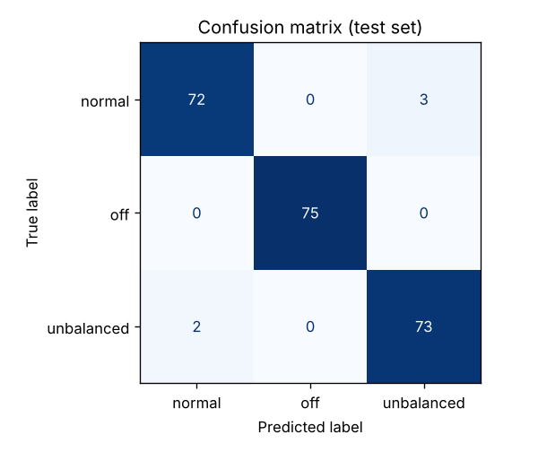

::: goal
**เป้าหมาย:** ได้โมเดล `motor_model.joblib` ที่วัดผลอย่างถูกวิธี และอ่าน confusion matrix ได้
:::

## เลือกได้ 2 ทาง

| ทาง | เหมาะกับ | วิธี |
|---|---|---|
| **PC** | ทำต่อเนื่องในเครื่องเดียว | `python train.py` |
| **Google Colab** | อยากเห็นทีละขั้นพร้อมกราฟ หรือเครื่องช้า | เปิด `notebooks/train_motor_model.ipynb` บน Colab |

[](https://colab.research.google.com/github/Boonkon/aiot-motor-guard/blob/main/notebooks/train_motor_model.ipynb)

## โมเดลที่ใช้: Random Forest

**ต้นไม้ตัดสินใจ (Decision Tree)** คือชุดคำถามแบบใช่/ไม่ใช่ เช่น "rms > 0.05 ไหม?" → "crest < 2.2 ไหม?" → *ไม่สมดุล*
ส่วน **Random Forest** คือการสร้างต้นไม้ 100 ต้นที่แต่ละต้นเห็นข้อมูลต่างกันเล็กน้อย แล้วให้ลงคะแนนเสียงข้างมาก
วิธีนี้แม่นและทนต่อข้อมูลรบกวนกว่าต้นไม้ต้นเดียว ข้อดีอีกข้อคือ **เทรนได้ในเวลาไม่ถึงวินาทีบน PC ทั่วไป**
และไม่ต้องใช้ GPU

## ลงมือ

```bash
cd python
python train.py                 # ใช้ data/ ถ้ามี ไม่มีจะใช้ data_demo/
```

ผลตัวอย่าง (จากข้อมูลจำลอง):

```text
ผลทดสอบกับข้อมูลที่โมเดลไม่เคยเห็น (25%):
              precision    recall  f1-score   support
      normal      0.973     0.960     0.966        75
         off      1.000     1.000     1.000        75
  unbalanced      0.961     0.973     0.967        75
    accuracy                          0.978       225

ความสำคัญของแต่ละฟีเจอร์:
  rms_y  0.273 #############
  rms    0.223 ###########
  rms_x  0.213 ##########
  rms_z  0.135 ######
  p2p    0.094 ####
  crest  0.046 ##
  f_dom  0.016
```

{width=420}

**วิธีอ่าน:** ตัวเลขนอกเส้นทแยงคือจุดที่โมเดลสับสน ในตัวอย่างนี้มีบางครั้งที่ *normal* ถูกทายเป็น *unbalanced*
ซึ่งเป็นเรื่องปกติ เพราะการสั่นของสองสถานะนี้มีช่วงที่ซ้อนทับกัน (เช่น ใบพัดปกติแต่โต๊ะสั่น)
ในบทที่ 5 เราจะรับมือเรื่องนี้ด้วย *การยืนยันซ้ำ* ก่อนแจ้งเตือน

## กับดัก 3 ข้อที่มือใหม่เจอบ่อย

::: callout-warning
## 1. วัดผลด้วยข้อมูลที่ใช้ฝึก
ถ้าทดสอบกับข้อมูลชุดเดียวกับที่ใช้ฝึก โมเดลจะได้ 100% เหมือนนักเรียนที่ท่องข้อสอบเก่ามา
จึงต้องแยกข้อมูล 25% ไว้ทดสอบโดยที่โมเดลไม่เคยเห็น (`train_test_split`)
:::

::: callout-warning
## 2. ใช้ฟีเจอร์ที่ "โกง" โดยไม่ตั้งใจ (Data Leakage)
เราตั้งใจ **ไม่ใส่ `temp` ให้โมเดล** ถ้าเก็บข้อมูล *ไม่สมดุล* ตอนบ่ายซึ่งห้องร้อนกว่า
โมเดลอาจเรียนรู้ว่า "ห้องร้อน = ไม่สมดุล" ซึ่งไม่ใช่ความจริงทางกายภาพ ฟีเจอร์ที่ใช้ต้องมี *เหตุผลทางฟิสิกส์* รองรับ
:::

::: callout-warning
## 3. โมเดลตอบได้แค่สิ่งที่เคยเห็น
ถ้าลูกปืนแตก (สถานะที่ไม่เคยมีในข้อมูลฝึก) โมเดลจำแนกจะ *เดา* หนึ่งใน 3 คำตอบอย่างมั่นใจ
เราจึงเพิ่ม **IsolationForest** เป็นตัวตรวจ "ของแปลก" ถ้าข้อมูลไม่เหมือนที่เคยฝึกเลย จะรายงานเป็น `unknown`
ส่วนนี้ทดลองได้ในข้อ 5 ของ Colab notebook
:::

## ลองเอง

1. เปลี่ยน `max_depth=6` เป็น `max_depth=1` ความแม่นยำเปลี่ยนอย่างไร? เพราะอะไร?
2. ลบฟีเจอร์ออกให้เหลือแค่ `rms` ตัวเดียว ยังแยก *normal* กับ *unbalanced* ได้ดีไหม?
3. ฝึกด้วยข้อมูลจำลอง แล้วทดสอบกับข้อมูลจริงจากพัดลมของคุณ เกิดอะไรขึ้น?
