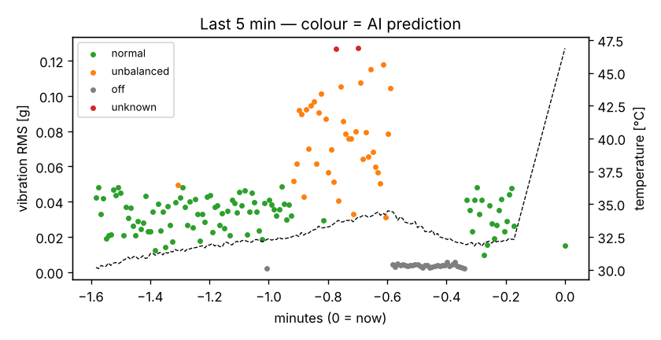

::: goal
**เป้าหมาย:** ช่างเปิดมือถือแล้วรู้ทันทีว่าเครื่องเป็นอย่างไร และได้รับแจ้งเตือนเมื่อมีปัญหา
:::

## ทำไมใช้ Telegram

ผู้ใช้ไม่ต้องติดตั้งแอปใหม่ แจ้งเตือนเด้งบนมือถือได้ทันที
และทำงานได้แม้ PC กับมือถืออยู่คนละเครือข่าย เพราะบอทเป็นฝ่าย *ดึง* ข้อความจากเซิร์ฟเวอร์ Telegram เอง (polling)
จึงไม่ต้องเปิดพอร์ตหรือมี IP สาธารณะ

## เริ่มบอท

ตรวจว่าใส่ `TELEGRAM_TOKEN` ใน `python/config.py` แล้ว ([บทที่ 0](00_setup.qmd)) จากนั้น

```bash
cd python
python bot.py
```

ใน Telegram ค้นหาชื่อบอทของคุณ แล้วพิมพ์ `/start`

| คำสั่ง | ผลลัพธ์ |
|---|---|
| `/status` | สถานะล่าสุดของทุกเครื่อง ผลที่ AI ทาย และความมั่นใจ |
| `/history 10` | กราฟการสั่น 10 นาทีล่าสุด ระบายสีตามที่ AI ทาย |
| `/subscribe` | รับการแจ้งเตือนอัตโนมัติ |
| `/unsubscribe` | เลิกรับการแจ้งเตือน |
| `/explain` | อธิบายระบบ AIoT นี้ (สำหรับผู้เรียนใหม่) |

ตัวอย่าง `/status`:

```text
🔧 fan01
AI ทายว่า: ไม่สมดุล/สั่นผิดปกติ (มั่นใจ 94%)
การสั่น RMS: 0.081 g · ความถี่เด่น 20 Hz
อุณหภูมิ 33.0°C · ความชื้น 60%
อัปเดตเมื่อ 1 วินาทีที่แล้ว
```

ตัวอย่าง `/history 5` (ทดสอบด้วย `simulator.py --scenario demo`):



สังเกตว่าในช่วงปกติจะมีจุดสีส้มโผล่ขึ้นมา 1–2 จุด จุดเหล่านี้คือครั้งที่โมเดลทายผิด
แต่ระบบ **ไม่ได้ส่งแจ้งเตือน** เพราะการรอ 5 วินาทีในบทที่ 5 กรองไว้แล้ว

## โค้ดทำงานอย่างไร

```{mermaid}
flowchart LR
  U["ผู้ใช้พิมพ์ /status"] --> TG["Telegram server"] --> B["bot.py"]
  B -- "SELECT ล่าสุด" --> DB[("SQLite<br/>ที่ gateway เขียน")]
  B --> TG --> U
  DB -- "ทุก 2 วินาที: มี alert ใหม่ไหม?" --> B
```

บอทกับ gateway **ไม่ได้คุยกันโดยตรง** ทั้งคู่ใช้ฐานข้อมูล SQLite เดียวกัน
ข้อดีคือถ้าบอทล่ม gateway ยังเก็บข้อมูลต่อได้ตามปกติ การแยกหน้าที่แบบนี้ทำให้ระบบทนต่อความผิดพลาดมากขึ้น

## ลองเอง

1. เพิ่มคำสั่ง `/threshold 40` ให้ผู้ใช้เปลี่ยนเกณฑ์อุณหภูมิได้ (ใบ้: ต้องเก็บค่าไว้ใน DB ให้ gateway อ่าน)
2. ให้ `/status` แสดงไอคอน 🟢🟠⚪🔴 ตามสถานะ
3. ถ้ามีคนในกลุ่มแชตหลายคน ควรให้ทุกคน `/subscribe` ได้ไหม? ถ้าเป็นโรงงานจริง ควรจำกัดสิทธิ์อย่างไร?
